# UNIT 3 — PACKAGE MANAGEMENT AND EXCEPTION HANDLING

**Subject:** Java Programming  
**Unit:** 3  
**Total Hours:** 9 Hours  
**Format:** Markdown — aligned, flowchart-rich, last-minute revision ready  

> 📝 **Using in Notion?** Notion does **not** render Mermaid flowcharts natively.  
> **Option A:** Open this file in VS Code / GitHub / Obsidian first → take screenshots of diagrams → paste into Notion.  
> **Option B:** Use Notion's native blocks (Callout, Table, Code) to recreate key diagrams manually.  
> **Option C:** Install a Mermaid plugin/extension in Notion if available.

---

## 📋 SYLLABUS MAPPING (9 Hours)

| S.No. | Syllabus Topic | Hours | Priority |
|:-----:|:---------------|:-----:|:--------:|
| 1 | Defining packages, package structure & naming conventions | 1.5 | ⭐⭐⭐ |
| 2 | Setting CLASSPATH | 0.5 | ⭐⭐ |
| 3 | Creating and using JAR files | 1 | ⭐⭐⭐ |
| 4 | `import` and `static import` | 0.5 | ⭐⭐ |
| 5 | Introduction to exceptions, types, Error vs Exception | 1 | ⭐⭐⭐ |
| 6 | try-catch-finally blocks, multiple catch blocks | 1 | ⭐⭐⭐ |
| 7 | Multi-catch using pipe (`|`) | 0.5 | ⭐⭐ |
| 8 | `throw` and `throws` keywords | 0.5 | ⭐⭐⭐ |
| 9 | Resource management — try-with-resources | 0.5 | ⭐⭐⭐ |
| 10 | Built-in and user-defined exceptions | 1 | ⭐⭐⭐ |
| 11 | Checked and unchecked exceptions | 0.5 | ⭐⭐⭐ |
| **Total** | | **9 Hours** | |

> 💡 **Last-minute tip:** Focus on try-catch-finally, throw vs throws, checked vs unchecked, and package naming — these are the most asked exam questions.

---

# PART A — PACKAGE MANAGEMENT

---

## 1. What is a Package?

A **package** in Java is a namespace (a folder-like container) that groups related classes, interfaces, and sub-packages together.

> Think of a package like a **folder on your computer** — it keeps related files together and prevents name clashes.

### Why do we need packages?

| Advantage | Explanation |
|:----------|:------------|
| ✅ Avoids name conflicts | Two classes with the same name can exist in different packages (e.g., `java.util.Date` vs `java.sql.Date`) |
| ✅ Better code organization | Large projects stay easy to maintain |
| ✅ Access protection | `public`, `protected`, `default` give controlled access between packages |
| ✅ Reusability | Ready-made classes in Java API (`java.util`, `java.io`, etc.) |
| ✅ Modular programming | Each package can be developed independently |

---

## 📦 Package Creation Flowchart

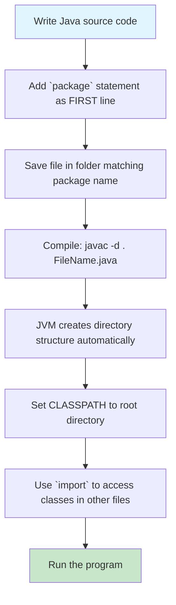

### 📁 Package Directory Structure Diagram

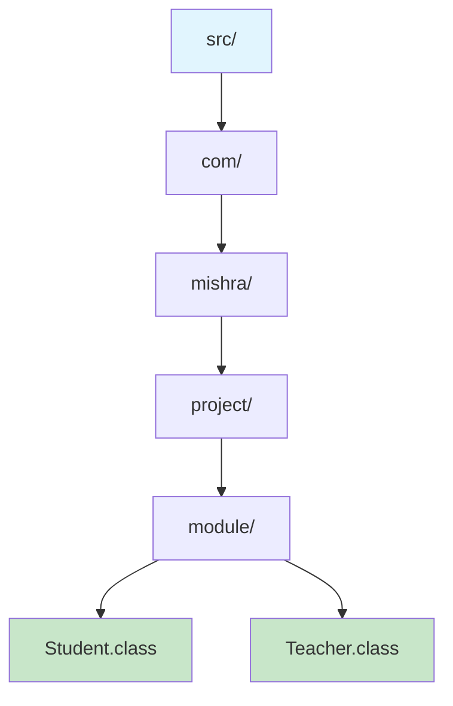

> **Package:** `com.mishra.project.module`  
> **Folder path:** `src/com/mishra/project/module/`  
> **Files:** `Student.class`, `Teacher.class` inside the `module/` folder

---

## 2. Types of Packages

| Type | Description | Examples |
|:-----|:------------|:---------|
| **Built-in (Predefined)** | Provided by JDK, automatically available | `java.lang`, `java.io`, `java.util`, `java.awt`, `java.applet` |
| **User-defined** | Created by the programmer for their application | `com.mishra.project`, `in.college.library` |

> `java.lang` is **automatically imported** in every Java program — you don't need to write `import java.lang.*;`.

---

## 3. Defining a Package — Syntax & Rules

```java
package com.mishra.project.module;

public class Student {
    String name;
    int rollNo;

    public void display() {
        System.out.println("Student: " + name + ", Roll: " + rollNo);
    }
}
```

### Rules to Remember
1. The `package` statement must be the **first statement** in the source file (only comments can precede it).
2. There can be **only one** package statement per file.
3. If no package is written, the class belongs to the **default (unnamed) package**.
4. The directory structure **must match** the package name exactly.

### Step-by-Step Example

```
Step 1: Create Message.java
   package mypack;
   public class Message {
       public void show() {
           System.out.println("Hello from mypack!");
       }
   }

Step 2: Compile
   javac -d . Message.java
   → Creates folder: mypack/Message.class

Step 3: Use in another file
   import mypack.Message;
   public class Test {
       public static void main(String[] args) {
           Message obj = new Message();
           obj.show();
       }
   }
```

---

## 4. Package Structure & Naming Conventions

### Naming Convention — Reverse Domain Name

| Component | Convention | Example |
|:---------|:-----------|:--------|
| Top-level | All lowercase | `com`, `org`, `edu`, `in` |
| Domain | Reversed domain | `com.mishra` |
| Project / Module | Lowercase, descriptive | `com.mishra.library` |
| Sub-packages | Lowercase | `com.mishra.library.books` |

### Valid vs Invalid Package Names

| ✅ Valid | ❌ Invalid | Reason |
|:---------|:-----------|:-------|
| `mypackage` | `MyPackage` | Uppercase not allowed |
| `schoolmanagement` | `student.details.` | Ends with dot |
| `com.company.project` | `123project` | Cannot start with number |
| `org.example.test` | `my package` | Space not allowed |
| `in.college.library` | `com.company#app` | `#` not allowed |
| `util` | `com..project` | Double dots not allowed |
| `service` | `my-pack` | Hyphen not allowed |
| `controller` | `return.app` | Keyword not allowed |
| `project1` | `com.company.Project` | Uppercase not allowed |
| `data2025` | `project@java` | `@` not allowed |

### 🏢 Package Naming Convention — Reverse Domain Diagram

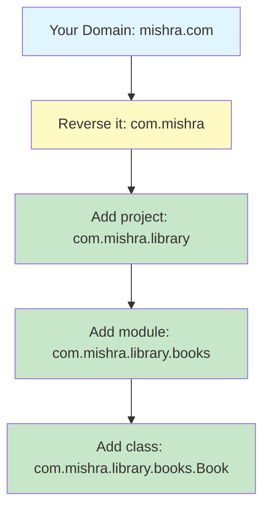

> **Rule:** Always use reverse domain name to guarantee uniqueness across organizations.

---

## 5. Access Modifiers × Packages

This is a critical exam topic — memorize this table.

| Modifier | Same Package | Different Package | With Inheritance (Subclass) |
|:---------|:-------------|:------------------|:----------------------------|
| `public` | ✅ Yes | ✅ Yes | ✅ Yes |
| `protected` | ✅ Yes | ❌ No | ✅ Yes |
| `default` (no modifier) | ✅ Yes | ❌ No | ❌ No |
| `private` | ❌ No | ❌ No | ❌ No |

### Quick Memory Aid
- **public** = Everyone can access
- **protected** = Same package + subclasses only
- **default** = Same package only
- **private** = Same class only

### 🔐 Access Modifier Visual Hierarchy

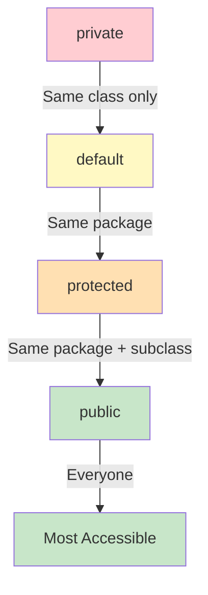

### 📦 Accessibility by Package Context

| Modifier | Same Package | Different Package | Same Package + Subclass | Different Package + Subclass |
|:---------|:-------------|:------------------|:------------------------|:-----------------------------|
| `private` | ✅ | ❌ | ❌ | ❌ |
| `default` | ✅ | ❌ | ❌ | ❌ |
| `protected` | ✅ | ❌ | ✅ | ✅ |
| `public` | ✅ | ✅ | ✅ | ✅ |

---

## 6. Setting the CLASSPATH

`CLASSPATH` tells the JVM / `javac` where to look for user-defined classes and packages.

### What is it?
An environment variable (or command-line option) containing a list of directories and JAR files.

> **`.` (dot)** means the current directory. Always include it so the JVM finds classes in the current folder.

### Ways to Set CLASSPATH

| Method | Command / Scope | Example |
|:-------|:----------------|:--------|
| Temporary (CMD) | Current session only | `set CLASSPATH=.;C:\myclasses` |
| Temporary (PowerShell/Bash) | Current session only | `export CLASSPATH=.:/home/user/classes` |
| Permanent | System Environment Variables | Control Panel → System → Advanced → Environment Variables |
| At compile time | `javac -cp` | `javac -cp .;lib.jar Main.java` |
| At run time | `java -cp` | `java -cp .;classes com.mishra.Main` |

### Real Example (from syllabus slides)

```bash
# Compile
javac -classpath ".;C:\KIET\Java 2026-27\java NOTES\Programs" Test.java

# Run
java -classpath ".;C:\KIET\Java 2026-27\java NOTES\Programs" Test
```

---

## 🔍 CLASSPATH Resolution Flowchart

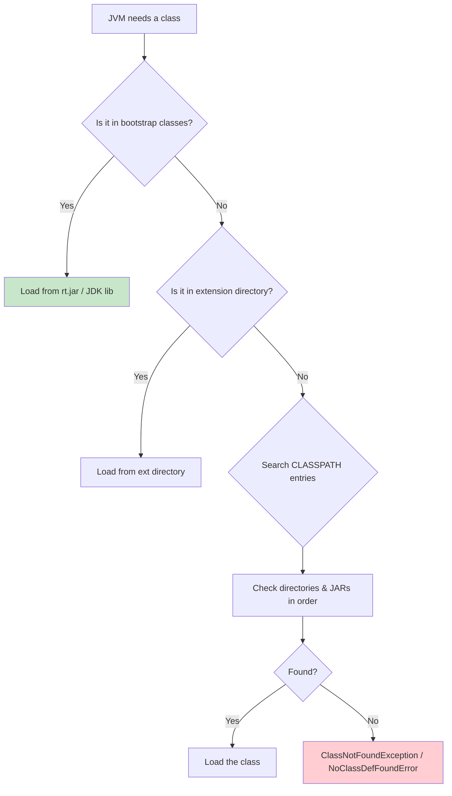

---

## 7. Creating and Using JAR Files

A **JAR (Java ARchive)** file bundles multiple classes, resources, and metadata into a single `.jar` file.

### Common `jar` Tool Commands

| Operation | Command | Meaning |
|:----------|:--------|:--------|
| Create | `jar cvf archive.jar *.class` | Create a JAR (c=create, v=verbose, f=file) |
| Create with manifest | `jar cvfm archive.jar manifest.txt *.class` | Include custom MANIFEST.MF |
| View contents | `jar tf archive.jar` | List files inside JAR (t=list) |
| Extract | `jar xf archive.jar` | Extract all files (x=extract) |
| Update | `jar uf archive.jar NewFile.class` | Add/update files (u=update) |
| Run executable JAR | `java -jar archive.jar` | Run if Main-Class is set in manifest |

### Example: Create & Use a JAR

```bash
# 1. Compile classes
javac -d classes com/mishra/*.java

# 2. Create JAR
jar cvf library.jar -C classes com

# 3. View contents
jar tf library.jar

# 4. Use JAR in another project
javac -cp .;library.jar Main.java      # Windows
javac -cp .:library.jar Main.java      # Linux/Mac

# 5. Run
java -cp .;library.jar Main
```

### MANIFEST.MF (to make JAR executable)

```
Manifest-Version: 1.0
Main-Class: com.mishra.Main
Class-Path: lib/helper.jar
```

Then run:
```bash
java -jar library.jar
```

### 📦 JAR Creation & Usage Workflow

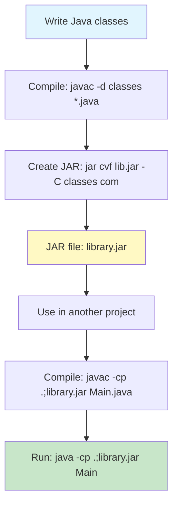

---

## 8. `import` Statement

Used to tell the compiler where to find classes so you don't write fully qualified names every time.

### Types of Import

| Import Style | Syntax | When to Use |
|:-------------|:-------|:------------|
| Single class | `import java.util.Scanner;` | Import one specific class |
| Wildcard | `import java.util.*;` | Import all classes in a package (not sub-packages) |
| Static import | `import static java.lang.Math.*;` | Import static members directly |

> **Note:** `import` statements come **after** the package statement and **before** the class declaration.

### Example

```java
package com.mishra.demo;

import java.util.ArrayList;
import java.util.List;          // single imports
import java.util.*;               // wildcard import

public class Demo {
    public static void main(String[] args) {
        List<String> names = new ArrayList<>();
        names.add("Alice");
        System.out.println(names);
    }
}
```

### 📥 Import & Static Import Workflow

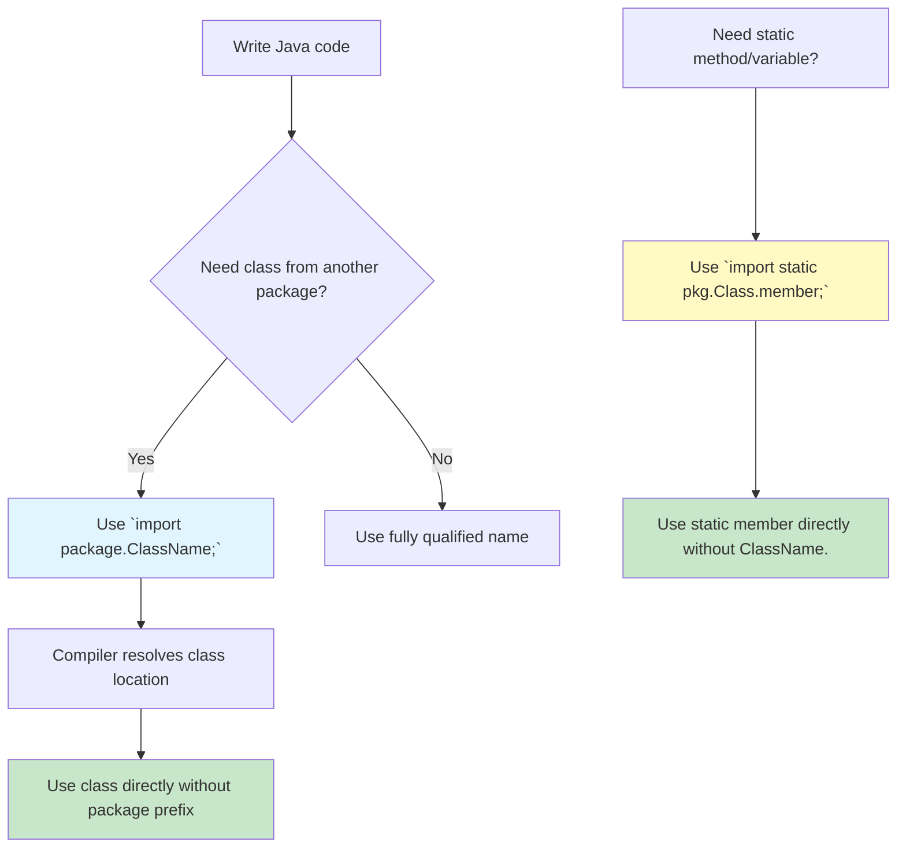

---

## 9. `static import` (Java 5+)

Lets you use static members (methods/variables) of a class without prefixing the class name.

### Syntax

```java
import static packageName.ClassName.staticMember;
import static packageName.ClassName.*;   // all static members
```

### Example — Built-in Class

```java
import static java.lang.Math.PI;
import static java.lang.Math.sqrt;
import static java.lang.System.out;

public class Circle {
    public static void main(String[] args) {
        double r = 5.0;
        double area = PI * sqrt(r);      // no Math. prefix needed
        out.println("Area: " + area);
    }
}
```

### Example — Your Own Class

```java
// File: tools/Utility.java
package tools;
public class Utility {
    public static int add(int a, int b) {
        return a + b;
    }
}

// File: Demo.java
import static tools.Utility.add;

public class Demo {
    public static void main(String[] args) {
        System.out.println(add(5, 3));   // prints 8
    }
}
```

⚠️ **Caution:** Overusing static imports makes code harder to read. Use sparingly.

---

## 📦 Package Management — One-Page Summary Table

| Concept | Key Point |
|:--------|:----------|
| `package` statement | First line in source file; defines namespace |
| Directory structure | Must mirror package name exactly |
| Naming | Reverse domain, all lowercase, no special chars |
| CLASSPATH | Tells JVM where to find classes/JARs; `.` = current dir |
| JAR | Bundles classes + resources; `jar cvf`, `jar tf`, `jar xf`, `java -jar` |
| `import` | Avoids fully qualified class names |
| `static import` | Imports static members directly |
| Access modifiers | `public` > `protected` > `default` > `private` across packages |

---

# PART B — EXCEPTION HANDLING

---

## 1. Introduction to Exceptions

An **exception** is an event that disrupts the normal flow of program execution during runtime.

### Common Examples
| Situation | Exception |
|:----------|:----------|
| Dividing a number by zero | `ArithmeticException` |
| Accessing invalid array index | `ArrayIndexOutOfBoundsException` |
| File not found | `FileNotFoundException` |
| Null object reference | `NullPointerException` |
| Invalid string-to-number conversion | `NumberFormatException` |

---

## 2. Exception Hierarchy

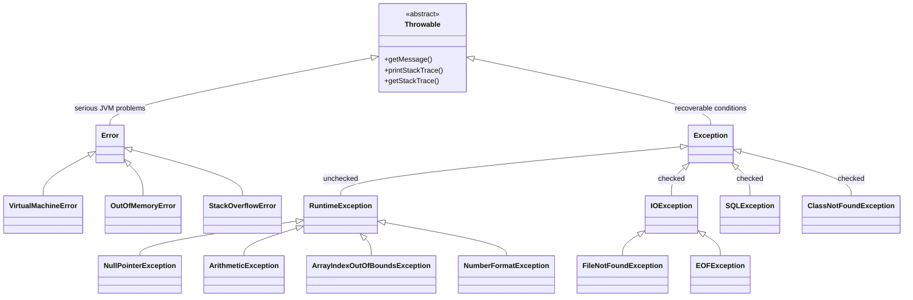

---

## 3. Error vs Exception

| Basis | Error | Exception |
|:------|:------|:----------|
| **Package** | `java.lang.Error` | `java.lang.Exception` |
| **Cause** | JVM / system-level failure | Application-level or runtime condition |
| **Recoverable** | ❌ No — program usually terminates | ✅ Yes — using try-catch |
| **Examples** | `OutOfMemoryError`, `StackOverflowError`, `VirtualMachineError` | `IOException`, `SQLException`, `NullPointerException` |
| **Handling** | Should NOT try to catch | Should catch and handle |

### ⚡ Error vs Exception Visual Comparison

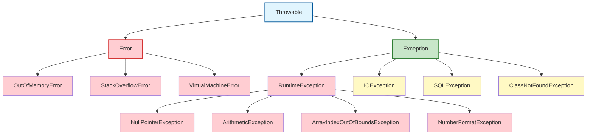

---

## 4. Checked vs Unchecked Exceptions

| | **Checked Exceptions** | **Unchecked Exceptions** |
|:---:|:---|:---|
| **Compile-time check?** | ✅ Yes — compiler forces handling | ❌ No — compiler does not force |
| **Subclass of** | `Exception` (but NOT `RuntimeException`) | `RuntimeException` or `Error` |
| **Must be handled?** | Yes — `try-catch` or `throws` | No — optional |
| **Examples** | `IOException`, `SQLException`, `ClassNotFoundException`, `FileNotFoundException` | `NullPointerException`, `ArithmeticException`, `ArrayIndexOutOfBoundsException`, `NumberFormatException` |
| **Typical cause** | External factors (file, network, DB) | Programming bugs (logic errors) |

### 🔄 Checked Exception Handling Flow (Compile-Time Enforcement)

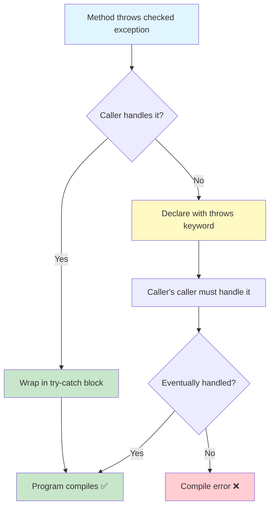

### 🌍 Real-World Exception Analogy

| Scenario | Java Equivalent |
|:---------|:----------------|
| Restaurant runs out of a dish | `Exception` thrown |
| Waiter tells you immediately | `throw` keyword |
| Menu says "may contain nuts" | `throws` keyword |
| You check ingredients before eating | `try-catch` block |
| Manager fixes the issue | `catch` block handles exception |
| You leave a review regardless | `finally` block always runs |

### 🔄 Checked vs Unchecked Decision Flowchart

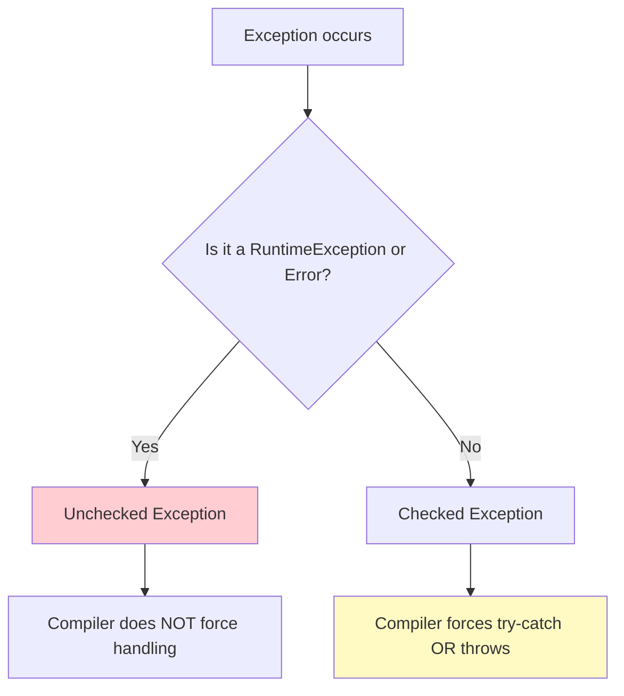

---

## 5. try-catch-finally Blocks

### Basic Syntax

```java
try {
    // code that may throw an exception
    int result = 10 / 0;
} catch (ArithmeticException e) {
    // handle specific exception
    System.out.println("Cannot divide by zero!");
} catch (Exception e) {
    // generic handler — keep at the END
    System.out.println("Some error: " + e.getMessage());
} finally {
    // always executes — cleanup code
    System.out.println("Finally block always runs.");
}
```

### Execution Flow

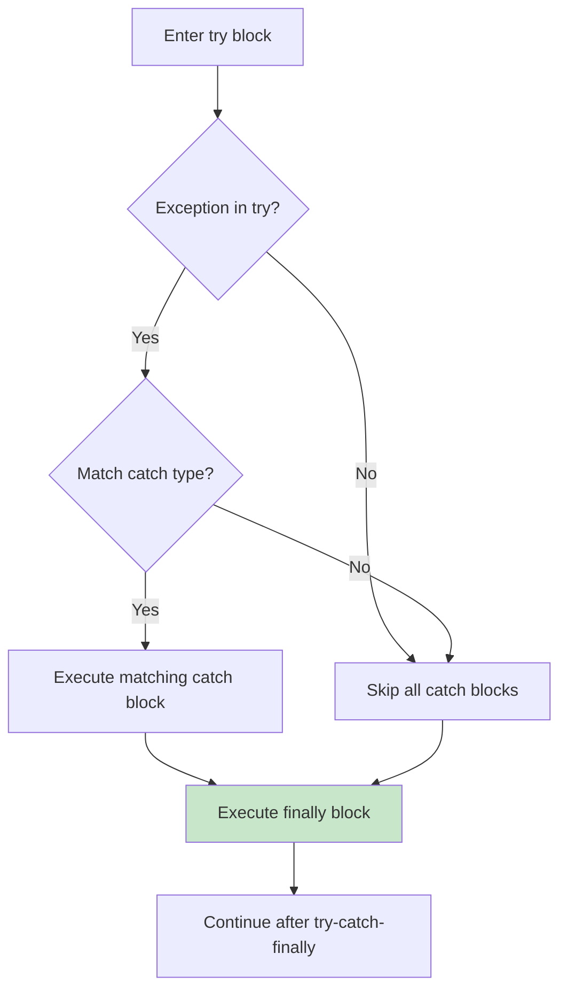

### Key Rules to Memorize
1. A `try` block must be followed by at least one `catch` OR one `finally`.
2. You can have multiple `catch` blocks, but only one `finally`.
3. `catch` blocks must be ordered **most specific → most general** (subclass before superclass).
4. `finally` runs even if `return`, `break`, or `continue` is used — **except** when `System.exit()` is called.

### 🔄 Complete Exception Handling Flow

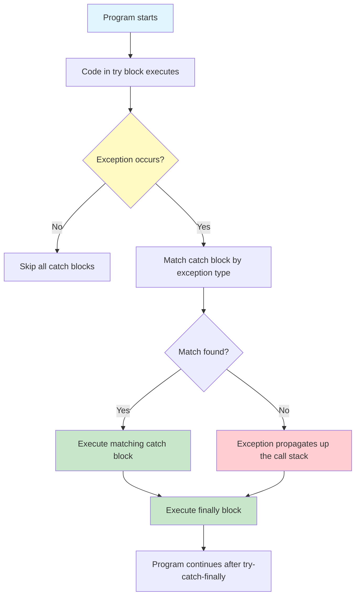

---

## 6. Multiple Catch Blocks

Use different catch blocks to handle different exception types differently.

```java
try {
    int[] arr = {1, 2, 3};
    System.out.println(arr[5]);          // ArrayIndexOutOfBoundsException
    int x = 10 / 0;                       // ArithmeticException (unreachable here)
} catch (ArrayIndexOutOfBoundsException e) {
    System.out.println("Invalid array index!");
} catch (ArithmeticException e) {
    System.out.println("Division by zero!");
} catch (Exception e) {
    System.out.println("General exception: " + e);
}
```

> ⚠️ Put subclass catch blocks **above** superclass catch blocks, otherwise you get a compile-time error ("exception already caught").

---

## 7. Multi-Catch using Pipe (`|`) — Java 7+

Catch multiple unrelated exception types in a single catch block using the `|` operator.

### Syntax

```java
catch (IOException | SQLException e) {
    log(e);
    throw new RuntimeException("Database/IO error", e);
}
```

### Example

```java
try {
    // some file and DB operation
} catch (FileNotFoundException | UnknownHostException e) {
    System.out.println("Resource not available: " + e.getMessage());
}
```

### Restriction
The exception variable `e` is **implicitly final** — you cannot reassign it inside the multi-catch block.

### 🎯 Multi-Catch Visual Diagram

```mermaid
flowchart TD
    A[Exception thrown] --> B{Catch Block 1: IOException \| SQLException?}
    B -- Yes --> C[Execute ONE handler for both]
    B -- No --> D{Catch Block 2: NullPointerException?}
    D -- Yes --> C
    D -- No --> E{Catch Block 3: Exception?}
    E -- Yes --> F[Generic handler - last resort]
    E -- No --> G[Exception propagates up]
    
    style A fill:#e1f5fe
    style C fill:#c8e6c9
    style F fill:#fff9c4
    style G fill:#ffcdd2
```

### 🆕 Java 7+ Multi-Catch Benefits

| Without Multi-Catch | With Multi-Catch (`|`) |
|:-------------------|:----------------------|
| Separate catch blocks for each type | One catch block for multiple types |
| Duplicate handling code | Single handling code |
| More verbose | Concise and clean |
| Variable not final | Variable is implicitly final |

---

## 8. `throw` vs `throws`

| Keyword | `throw` | `throws` |
|:-------:|:--------|:---------|
| **Used with** | An exception **instance/object** | Exception **class names** |
| **Location** | Inside a method body | In method signature |
| **Purpose** | Explicitly throw an exception | Declare that a method may throw exceptions |
| **Can throw multiple?** | No (one object at a time) | Yes (comma-separated list) |
| **Checked exception** | Must be caught or declared | Must be declared by caller |

### `throw` Example

```java
public void validateAge(int age) {
    if (age < 18) {
        throw new IllegalArgumentException("Age must be 18 or above");
    }
    System.out.println("Valid age");
}
```

### `throws` Example

```java
import java.io.*;

public void readFile(String fileName) throws IOException, FileNotFoundException {
    FileReader fr = new FileReader(fileName);
    // ...
}
```

### `throw` vs `throws` Flowchart

```mermaid
flowchart TD
    A[Method wants to signal error] --> B{Throw object right now?}
    B -- Yes --> C[throw new ExceptionType("msg");]
    B -- No --> D[Declare in signature: throws ExceptionType]
    C --> E[Exception created and thrown immediately]
    E --> F[Runtime: exception propagates up call stack]
    D --> G[Compiler forces caller to handle it]
    G --> H[Caller must use try-catch OR declare throws]
    
    style A fill:#e1f5fe
    style C fill:#c8e6c9
    style D fill:#fff9c4
    style F fill:#ffcdd2
    style H fill:#c8e6c9
```

### 🎯 `throw` vs `throws` — Real-World Analogy

```mermaid
flowchart TD
    A[Situation: You found a problem] --> B{Can you fix it now?}
    B -- Yes --> C[throw: Fix it immediately - "I throw this error!"]
    B -- No --> D[throws: Warn others - "This method might cause this error"]
    
    C --> E[Example: throw new ArithmeticException("/ by zero")]
    D --> F[Example: public void read() throws IOException]
    
    E --> G[Exception happens RIGHT NOW]
    F --> G2[Exception MIGHT happen later]
    
    style B fill:#fff9c4
    style C fill:#c8e6c9
    style D fill:#c8e6c9
    style G fill:#ffcdd2
    style G2 fill:#ffcdd2
```

---

## 9. Resource Management — try-with-resources (Java 7+)

Used for objects that implement `AutoCloseable` or `Closeable` (files, sockets, database connections, etc.). Resources are closed **automatically**.

### Syntax

```java
try (FileReader fr = new FileReader("data.txt");
     BufferedReader br = new BufferedReader(fr)) {
    String line = br.readLine();
    System.out.println(line);
} catch (IOException e) {
    e.printStackTrace();
}
// fr and br are closed automatically here
```

### Old way (try-finally) vs try-with-resources

```java
// OLD - verbose and error-prone
BufferedReader br = null;
try {
    br = new BufferedReader(new FileReader("data.txt"));
    // use br
} catch (IOException e) {
    e.printStackTrace();
} finally {
    if (br != null) {
        try { br.close(); } catch (IOException e) { /* ignore */ }
    }
}
```

### try-with-resources Flowchart

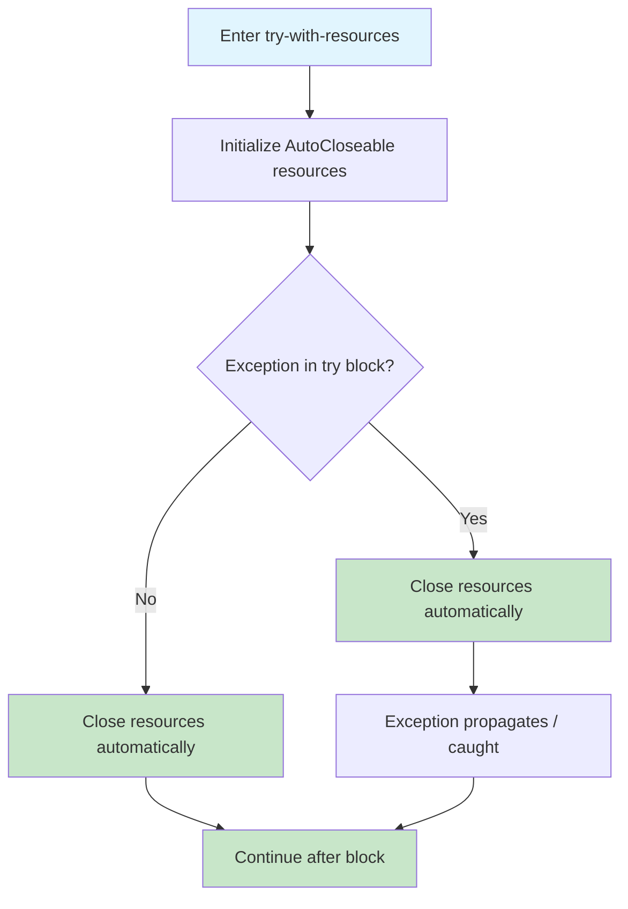

### 🆕 try-finally (Old) vs try-with-resources (New)

```mermaid
flowchart TD
    A[Old Way: try-finally] --> B[Manual resource management]
    B --> C[Must call close() in finally]
    C --> D[Null check before close()]
    D --> E[Try-catch inside finally for close()]
    E --> F[Verbose and error-prone]
    
    G[New Way: try-with-resources] --> H[Automatic resource management]
    H --> I[Resources declared in try()]
    I --> J[JVM closes automatically]
    J --> K[Concise and safe]
    
    style F fill:#ffcdd2
    style K fill:#c8e6c9
```

### 📊 Comparison Table

| Feature | try-finally (Old) | try-with-resources (New) |
|:--------|:------------------|:-------------------------|
| Resource closing | Manual (`close()`) | Automatic |
| Code length | Verbose | Concise |
| Exception safety | Can miss close() | Guaranteed close() |
| Java version | All versions | Java 7+ |
| Resource type | Any object | Must implement AutoCloseable |

---

## 10. Built-in Exceptions (Commonly Used)

| Exception | When it occurs | Type |
|:----------|:---------------|:-----:|
| `ArithmeticException` | Dividing by zero | Unchecked |
| `NullPointerException` | Calling method/field on null reference | Unchecked |
| `ArrayIndexOutOfBoundsException` | Invalid array index | Unchecked |
| `NumberFormatException` | Converting invalid string to number | Unchecked |
| `ClassNotFoundException` | Class not found in classpath | Checked |
| `IOException` | General I/O failure | Checked |
| `FileNotFoundException` | File does not exist | Checked |
| `EOFException` | End of file reached unexpectedly | Checked |
| `SQLException` | Database access error | Checked |
| `InterruptedException` | Thread interrupted | Checked |

---

## 11. User-Defined (Custom) Exceptions

You can create your own exception by extending `Exception` (checked) or `RuntimeException` (unchecked).

### Custom Checked Exception

```java
// File: com/mishra/banking/exception/InsufficientBalanceException.java
package com.mishra.banking.exception;

public class InsufficientBalanceException extends Exception {
    public InsufficientBalanceException(String message) {
        super(message);
    }
}
```

### Using the Custom Exception

```java
package com.mishra.banking;

import com.mishra.banking.exception.InsufficientBalanceException;

public class Account {
    private double balance;

    public Account(double initialBalance) {
        this.balance = initialBalance;
    }

    public void withdraw(double amount) throws InsufficientBalanceException {
        if (amount > balance) {
            throw new InsufficientBalanceException(
                "Insufficient funds! Available: " + balance
            );
        }
        balance -= amount;
        System.out.println("Withdrawn: " + amount + ". New balance: " + balance);
    }

    public static void main(String[] args) {
        Account acc = new Account(1000);
        try {
            acc.withdraw(1500);
        } catch (InsufficientBalanceException e) {
            System.out.println("Caught: " + e.getMessage());
        }
    }
}
```

### Custom Unchecked Exception

```java
public class InvalidAgeException extends RuntimeException {
    public InvalidAgeException(String message) {
        super(message);
    }
}
```

### 🎯 Custom Exception Creation Flow

```mermaid
flowchart TD
    A[Decide: Checked or Unchecked?] --> B{Checked?}
    B -- Yes --> C[Extend `Exception` class]
    B -- No --> D[Extend `RuntimeException` class]
    C --> E[Create constructor with message]
    D --> E
    E --> F[Call `super(message)`]
    F --> G[Use `throw` to throw the exception]
    G --> H[Catch with try-catch or declare with throws]
    
    style A fill:#e1f5fe
    style C fill:#fff9c4
    style D fill:#fff9c4
    style G fill:#c8e6c9
    style H fill:#c8e6c9
```

---

## 12. Complete Working Example (Packages + Exceptions)

```java
// File: com/mishra/utils/MathUtils.java
package com.mishra.utils;

public class MathUtils {
    public static int divide(int a, int b) throws ArithmeticException {
        if (b == 0) {
            throw new ArithmeticException("Division by zero is not allowed");
        }
        return a / b;
    }
}
```

```java
// File: Main.java
import com.mishra.utils.MathUtils;
import static com.mishra.utils.MathUtils.divide;

public class Main {
    public static void main(String[] args) {
        try {
            int result = divide(10, 2);
            System.out.println("Result: " + result);
            divide(10, 0); // will throw
        } catch (ArithmeticException e) {
            System.out.println("Error: " + e.getMessage());
        } finally {
            System.out.println("Execution completed.");
        }
    }
}
```

---

# 📝 LAST-MINUTE REVISION — ONE-PAGE SUMMARY

| Topic | Remember This |
|:------|:--------------|
| Package | `package` statement is first; folder structure must match package name |
| CLASSPATH | Tells JVM where to find classes; `.` means current directory |
| JAR | `jar cvf` create, `jar tf` list, `jar xf` extract, `java -jar` run |
| import | Brings classes into scope; wildcard `*` imports all in package |
| static import | Imports static methods/variables directly; use sparingly |
| Access modifiers | `public` = all, `protected` = same pkg + subclass, `default` = same pkg, `private` = same class |
| Error | JVM failure, not recoverable (`OutOfMemoryError`) |
| Exception | Recoverable; checked or unchecked |
| Checked | Checked at compile time; must use try-catch or throws |
| Unchecked | Not checked at compile time; usually programming bugs |
| try-catch-finally | try = risky code, catch = handle, finally = cleanup (always runs) |
| Multi-catch `\|` | Java 7+; catch multiple types in one block; variable is final |
| throw | Throws an exception object manually inside method |
| throws | Declares exceptions in method signature |
| try-with-resources | Auto-closes `AutoCloseable` resources; Java 7+ |

---

# ✅ CHECKPOINT QUESTIONS (Exam Prep)

1. What is the difference between `throw` and `throws`?
2. Can a `try` block exist without `catch`? (Yes, if followed by `finally`)
3. Why must subclass catch blocks come before superclass catch blocks?
4. What happens if `System.exit(0)` is called inside a `try` block? (`finally` does NOT run)
5. What is the output order when both `try` and `catch` have `return` statements?
6. Difference between `ClassNotFoundException` and `NoClassDefFoundError`?
7. How do you make a JAR file executable? (`Main-Class` in MANIFEST.MF)
8. When should you create a user-defined exception?
9. What does `.` mean in CLASSPATH?
10. Can `import java.util.*;` import sub-packages like `java.util.concurrent`? (No)

### 🆚 ClassNotFoundException vs NoClassDefFoundError

| ClassNotFoundException | NoClassDefFoundError |
|:-----------------------|:---------------------|
| Checked Exception | Error |
| Class not found at runtime | Class was available at compile time but missing at runtime |
| Caused by wrong CLASSPATH | Caused by failed static initialization |
| `catch` block can handle it | Cannot be caught (fatal) |

### 🆚 ClassNotFoundException vs NoClassDefFoundError Flowchart

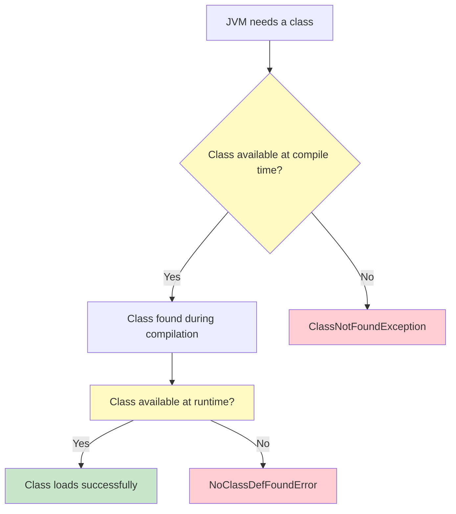

---

## 🖼️ IMAGES & NOTION IMPORT GUIDE

### Diagrams Available in Unit 3

| # | Diagram | Type | Location |
|:--|:--------|:----:|:---------|
| 1 | Package Creation Flow | Mermaid flowchart | Part A, Section 1 |
| 2 | Package Directory Structure | Mermaid flowchart | Part A, Section 1 |
| 3 | Package Naming Convention | Mermaid flowchart | Part A, Section 4 |
| 4 | CLASSPATH Resolution Flow | Mermaid flowchart | Part A, Section 6 |
| 5 | JAR Creation & Usage Workflow | Mermaid flowchart | Part A, Section 7 |
| 6 | Import & Static Import Workflow | Mermaid flowchart | Part A, Section 8 |
| 7 | Access Modifier Hierarchy | Mermaid flowchart | Part A, Section 5 |
| 8 | Error vs Exception Hierarchy | Mermaid flowchart | Part B, Section 3 |
| 9 | Checked vs Unchecked Decision | Mermaid flowchart | Part B, Section 4 |
| 10 | Checked Exception Handling Flow | Mermaid flowchart | Part B, Section 4 |
| 11 | Complete Exception Handling Flow | Mermaid flowchart | Part B, Section 5 |
| 12 | try-catch-finally Execution Flow | Mermaid flowchart | Part B, Section 5 |
| 13 | Multi-catch Visual Diagram | Mermaid flowchart | Part B, Section 7 |
| 14 | throw vs throws Flowchart | Mermaid flowchart | Part B, Section 8 |
| 15 | throw vs throws Real-World Analogy | Mermaid flowchart | Part B, Section 8 |
| 16 | try-with-resources Flowchart | Mermaid flowchart | Part B, Section 9 |
| 17 | try-finally vs try-with-resources | Mermaid flowchart | Part B, Section 9 |
| 18 | Custom Exception Creation Flow | Mermaid flowchart | Part B, Section 11 |
| 19 | ClassNotFoundException vs NoClassDefFoundError | Mermaid flowchart | Part B, Section 11 |

> ⚠️ **Unit 3 PPTX had no embedded images.** All diagrams are Mermaid code blocks.

### How to Import into Notion

**Step 1:** Open this `.md` file in **VS Code**, **GitHub**, or **Obsidian** (Mermaid renders there).

**Step 2:** For each diagram:
- Take a screenshot (Windows: `Win + Shift + S`, Mac: `Cmd + Shift + 4`)
- Or copy the Mermaid code block and paste into a Notion code block

**Step 3:** In Notion:
- Create a new page
- Paste screenshots as image blocks (`/image`)
- Use tables (`/table`) for comparison tables
- Use callouts (`/callout`) for tips and warnings
- Use code blocks (`/code`) for Java code examples

**Alternative:** Use a Mermaid live editor (mermaid.live) → export diagram as PNG → upload to Notion.

---

**End of Unit 3 Notes**  
*Good luck with your exam! 🎓*
