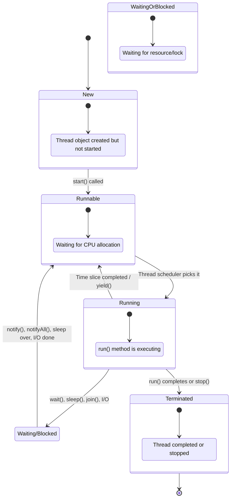
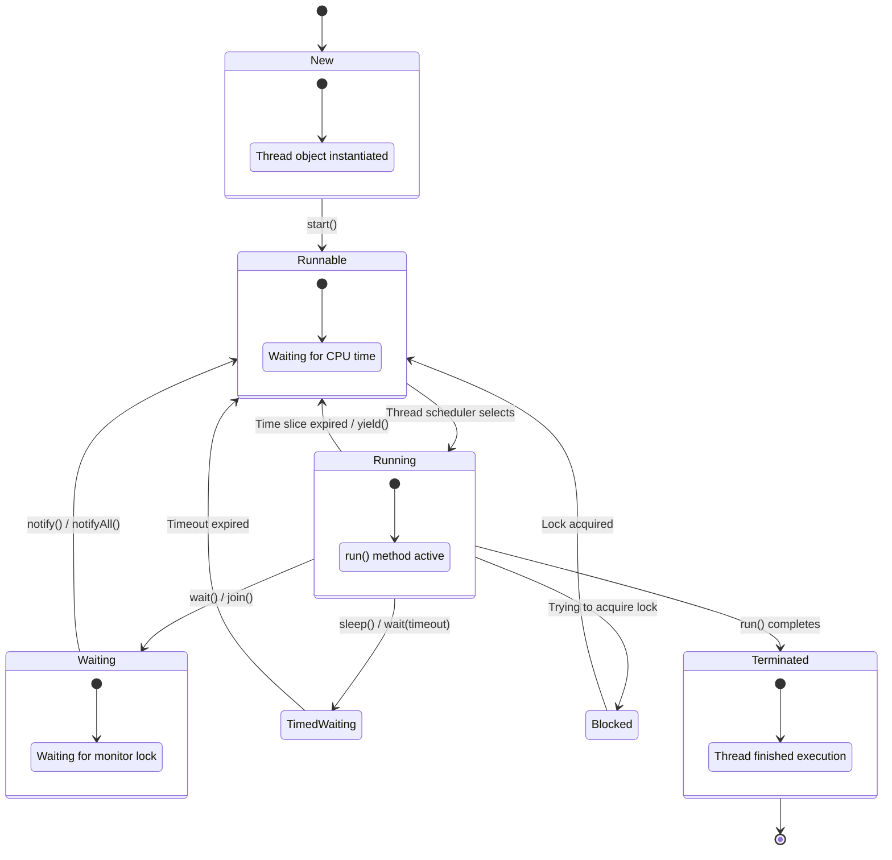
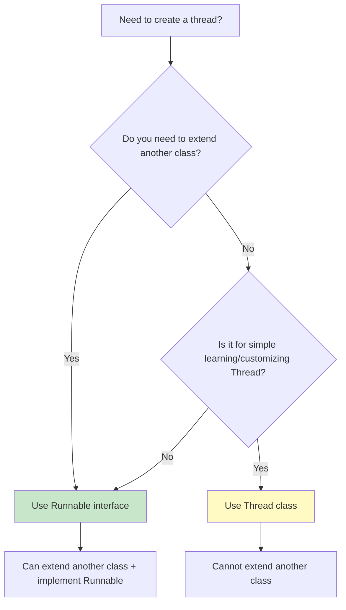
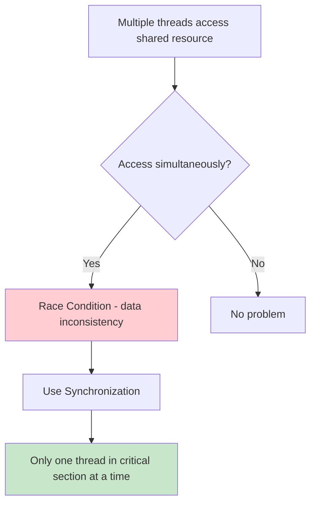

# UNIT 4 — MULTI-THREADING AND FILE HANDLING

**Subject:** Java Programming  
**Unit:** 4  
**Total Hours:** 9 Hours  
**Format:** Markdown — aligned, flowchart-rich, last-minute revision ready  

> 📝 **Using in Notion?** Notion does **not** render Mermaid flowcharts natively.  
> **Option A:** Open this file in VS Code / GitHub / Obsidian first → take screenshots of diagrams → paste into Notion.  
> **Option B:** Use Notion's native blocks (Callout, Table, Code) to recreate key diagrams manually.  
> **Option C:** Install a Mermaid plugin/extension in Notion if available.  
> 📷 **Image included:** Thread Life Cycle diagram (extracted from PPTX slide 49) is embedded below.

---

## 📋 SYLLABUS MAPPING (9 Hours)

| S.No. | Syllabus Topic | Hours | Priority |
|:-----:|:---------------|:-----:|:--------:|
| 1 | Thread basics & thread life cycle | 1 | ⭐⭐⭐ |
| 2 | Creating threads (Thread class & Runnable) | 1 | ⭐⭐⭐ |
| 3 | Thread priorities | 0.5 | ⭐⭐ |
| 4 | Thread synchronization | 1 | ⭐⭐⭐ |
| 5 | Inter-thread communication | 1 | ⭐⭐⭐ |
| 6 | Modern concurrency (virtual threads, executor framework, concurrent utilities) | 1.5 | ⭐⭐⭐ |
| 7 | Basics of file handling, creating new files | 0.5 | ⭐⭐⭐ |
| 8 | Byte and character streams | 1 | ⭐⭐⭐ |
| 9 | Modern file handling using NIO (Files & Paths) | 1 | ⭐⭐⭐ |
| 10 | Reading & writing files, keyboard input | 0.5 | ⭐⭐⭐ |
| **Total** | | **9 Hours** | |

> 💡 **Last-minute tip:** Focus on thread life cycle, synchronization (synchronized keyword), wait/notify, NIO Files/Paths, and keyboard input — these carry the most weight in exams.

---

# PART A — MULTI-THREADING

---

## 1. What is a Thread?

A **thread** in Java is a lightweight unit of a process that executes a task independently. Java supports **multithreading**, which means executing two or more threads simultaneously within a single program.

> A program with multiple threads is called a **multithreaded application**.

---

## 2. Process vs Thread

| Basis | Process | Thread |
|:------|:--------|:-------|
| **Definition** | Independent program in execution | Sub-part of a process |
| **Memory** | Has its own memory space | All threads of same process share memory |
| **Weight** | Heavyweight, costly to create | Lightweight, faster to create |
| **Communication** | Inter-process communication (IPC) is complex | Inter-thread communication is simple |
| **Example** | A web browser | Each tab, download, video inside the browser |

---

## 🔄 Thread Life Cycle



### 🖼️ Thread Life Cycle Diagram (from PPTX)


*Above: Original thread life cycle diagram from the syllabus PPTX (slide 49).*

### Thread States Explained

| State | Description |
|:------|:------------|
| **New** | Thread object is created but `start()` not yet called |
| **Runnable** | Thread is ready to run, waiting for CPU allocation |
| **Running** | Thread is executing its `run()` method |
| **Waiting / Blocked** | Thread is waiting for a resource, lock, or another thread |
| **Terminated / Dead** | Thread has completed execution or has been stopped |

### 🔄 Thread State Transition Diagram (Detailed)



---

## 3. Creating Threads in Java

There are **two ways** to create threads:

### Approach A — By Extending `Thread` Class

```java
class MyThread extends Thread {
    public void run() {
        System.out.println("Thread is running...");
    }
}

public class Demo {
    public static void main(String[] args) {
        MyThread t = new MyThread();  // thread is in NEW state
        t.start();                    // thread moves to RUNNABLE
    }
}
```

**Key points:**
- `run()` → contains the code that executes in the thread
- `start()` → requests JVM to start a new thread; JVM invokes `run()` automatically
- **Never call `run()` directly** — it executes like a normal method, not in a new thread
- Cannot extend another class (Java doesn't support multiple inheritance)

### Approach B — By Implementing `Runnable` Interface

```java
class MyTask implements Runnable {
    public void run() {
        System.out.println("Task is running...");
    }
}

public class Demo {
    public static void main(String[] args) {
        MyTask task = new MyTask();
        Thread t = new Thread(task);  // Thread wraps the Runnable
        t.start();
    }
}
```

**Key points:**
- `MyTask` = what work to do (the task)
- `Thread` = who will execute that work
- `start()` is **not available** in `Runnable`
- Can extend another class while implementing `Runnable`
- **Preferred approach** in real-world development

### 🧵 Thread Creation Workflow Diagram

```mermaid
flowchart TD
    A[Need to create a thread?] --> B{Extend another class?}
    B -- Yes --> C[Implement Runnable interface]
    B -- No --> D{Simple learning?}
    D -- Yes --> E[Extend Thread class]
    D -- No --> C
    
    C --> F[Create Runnable object]
    F --> G[Pass to Thread constructor]
    G --> H[Call t.start()]
    
    E --> I[Create Thread subclass object]
    I --> J[Call t.start()]
    
    H --> K[Thread runs run() method]
    J --> K
    
    style C fill:#c8e6c9
    style E fill:#fff9c4
    style K fill:#c8e6c9
```

---

## 🧵 Thread Class vs Runnable Interface



| Basis | `Thread` Class | `Runnable` Interface |
|:------|:---------------|:---------------------|
| Keyword | `extends Thread` | `implements Runnable` |
| Type | Class | Interface |
| Purpose | Represents and manages a thread | Defines the task to execute |
| `run()` method | Override `run()` | Implement `run()` |
| `start()` method | Available directly | **Not available** in Runnable |
| Object creation | `MyThread t = new MyThread();` | `MyTask t = new MyTask(); new Thread(t).start();` |
| Starting execution | `t.start();` | `new Thread(task).start();` |
| Inheritance | Cannot extend another class | Can extend another class |
| Task sharing | Task tied to Thread subclass | Same task object shared by multiple threads |
| Preferred for | Learning, customizing Thread behavior | Real-world development |

---

## ▶️ `start()` vs `run()`

| `t.start()` | `t.run()` |
|:------------|:----------|
| Creates a **new thread** of execution | Does **not** create a new thread |
| JVM executes `run()` in the new thread | Executes `run()` like a normal method call |
| Main thread and child thread execute **concurrently** | Execution occurs **sequentially** in calling thread |
| Used for **multithreading** | Used as an ordinary method call |

> ⚠️ **Common exam mistake:** Calling `t.run()` directly does NOT start a new thread. Always use `t.start()`.

### ⚡ start() vs run() Flowchart

```mermaid
flowchart TD
    A[Call t.start()] --> B[Creates NEW thread of execution]
    B --> C[JVM calls run() in new thread]
    C --> D[Main thread and child run CONCURRENTLY]
    
    E[Call t.run()] --> F[Does NOT create new thread]
    F --> G[Executes run() like normal method]
    G --> H[Sequential execution in calling thread]
    
    style A fill:#c8e6c9
    style B fill:#c8e6c9
    style C fill:#c8e6c9
    style D fill:#c8e6c9
    
    style E fill:#ffcdd2
    style F fill:#ffcdd2
    style G fill:#ffcdd2
    style H fill:#ffcdd2
```

---

## 4. Common Thread Methods

| Method | Description |
|:-------|:------------|
| `start()` | Creates a new thread and makes it runnable. Can be called only once. |
| `run()` | The new thread begins its life inside this method. |
| `sleep(long millis)` | Pauses the thread for the given milliseconds. Throws `InterruptedException`. |
| `yield()` | Hints to scheduler that current thread is willing to pause. Moves RUNNING → RUNNABLE. |
| `join()` | Makes the current thread wait for another thread to finish. |
| `setPriority(int)` | Sets thread priority (1-10). |
| `getPriority()` | Returns current thread priority. |
| `getName()` / `setName()` | Gets or sets thread name. |
| `currentThread()` | Returns reference to the currently executing thread. |
| `isAlive()` | Tests if thread is still running. |

### `sleep()` Example

```java
class MyThread extends Thread {
    public void run() {
        System.out.println(getName() + " is running...");
        try {
            Thread.sleep(500);  // sleeps 500 milliseconds
        } catch (InterruptedException e) {
            System.out.println(getName() + " was interrupted");
        }
        System.out.println(getName() + " has finished.");
    }
}
```

### `yield()` Example

```java
class MyThread extends Thread {
    public void run() {
        for (int i = 1; i <= 5; i++) {
            System.out.println(Thread.currentThread().getName() + " : " + i);
            Thread.yield();  // hint to scheduler
        }
    }
}
```

### `join()` Example

```java
Thread t1 = new Thread(() -> { /* work */ });
Thread t2 = new Thread(() -> { /* work */ });

t1.start();
t2.start();

t1.join();  // main thread waits for t1 to finish
t2.join();  // main thread waits for t2 to finish

System.out.println("Both threads completed.");
```

---

## 5. Thread Priorities

Every thread has a priority. When created, it inherits the priority of the thread that created it.

| Constant | Value | Description |
|:---------|:------|:------------|
| `Thread.MIN_PRIORITY` | 1 | Lowest priority |
| `Thread.NORM_PRIORITY` | 5 | Default priority (normal) |
| `Thread.MAX_PRIORITY` | 10 | Highest priority |

### Setting and Getting Priority

```java
t1.setPriority(Thread.MIN_PRIORITY);   // 1
t2.setPriority(Thread.NORM_PRIORITY);  // 5
t3.setPriority(Thread.MAX_PRIORITY);   // 10

System.out.println(t.getPriority());
```

### Important Rules About Priority

| Rule | Explanation |
|:-----|:------------|
| Default priority = 5 | Every new thread starts at `NORM_PRIORITY` |
| Inheritance | New thread inherits parent thread's priority |
| Just a hint | Priority is a suggestion to the scheduler — **not guaranteed** |
| Same priority | Scheduling becomes round-robin or time-slicing depending on OS |

### 📊 Thread Priority Visual Diagram

```mermaid
flowchart TD
    A[Thread Priority Range] --> B[1: MIN_PRIORITY]
    A --> C[5: NORM_PRIORITY (Default)]
    A --> D[10: MAX_PRIORITY]
    
    B --> E[Lowest - gets least CPU time]
    C --> F[Normal - default for all threads]
    D --> G[Highest - gets most CPU time]
    
    style B fill:#ffcdd2
    style C fill:#fff9c4
    style D fill:#c8e6c9
    
    style E fill:#ffcdd2
    style F fill:#fff9c4
    style G fill:#c8e6c9
```

---

## 6. Thread Synchronization

**Synchronization** ensures that only one thread can access a shared resource at a time, preventing race conditions and data inconsistency.

### Why Synchronization is Needed



**Without synchronization example (race condition):**
```java
class Counter {
    int count = 0;
    void increment() { count++; }  // NOT thread-safe
}
// Two threads incrementing 1000 times each → expected 2000, actual may be 1837
```

### Ways to Achieve Synchronization

#### Method 1: Synchronized Methods

```java
class Counter {
    private int count = 0;
    
    public synchronized void increment() {   // lock on this object
        count++;
    }
    
    public synchronized int getCount() {     // lock on this object
        return count;
    }
}
```

#### Method 2: Synchronized Block

```java
class Counter {
    private int count = 0;
    
    public void increment() {
        synchronized(this) {  // lock only this block
            count++;
        }
    }
}
```

**Advantage:** Synchronize only a smaller part of a method, improving concurrency.

#### Method 3: Static Synchronization

```java
class Printer {
    static synchronized void print(int n) {  // lock on Class object
        for (int i = 1; i <= 5; i++) {
            System.out.println(n * i);
        }
    }
}
```

**Key difference:** Instance sync locks on `this`; static sync locks on the `Class` object.

### 🔒 Synchronization Lock Mechanism Diagram

```mermaid
flowchart TD
    A[Thread 1 wants to access shared resource] --> B{Is lock available?}
    B -- Yes --> C[Thread 1 acquires lock]
    B -- No --> D[Thread 1 waits (BLOCKED)]
    
    C --> E[Thread 1 executes synchronized block]
    E --> F[Thread 1 releases lock]
    
    D --> G[Thread 2 holds lock]
    G --> H[Thread 2 releases lock]
    H --> B
    
    F --> I[Other threads can now acquire lock]
    
    style A fill:#e1f5fe
    style C fill:#c8e6c9
    style D fill:#ffcdd2
    style F fill:#c8e6c9
    style I fill:#c8e6c9
```

### 🔒 Lock Types Comparison

| Lock Type | What is locked | Scope |
|:----------|:---------------|:------|
| Instance synchronized method | `this` object | Entire method |
| Static synchronized method | `Class` object | Entire method (all instances) |
| Synchronized block | Any object (e.g., `this`) | Only the block |

---

## 7. Inter-Thread Communication

Threads communicate and coordinate using `wait()`, `notify()`, and `notifyAll()` — all defined in the `Object` class.

### Methods Summary

| Method | Description | Lock Released? |
|:-------|:------------|:--------------:|
| `wait()` | Thread pauses and releases lock until notified | ✅ Yes |
| `notify()` | Wakes up one waiting thread | ❌ No |
| `notifyAll()` | Wakes up all waiting threads | ❌ No |

**Rules:**
- Must be called inside a `synchronized` block/method
- Must be wrapped in `try-catch` for `InterruptedException`
- Called on the **shared object** whose lock the thread holds

### Producer-Consumer Example

```java
class Shared {
    int data;
    boolean hasData = false;

    synchronized void produce(int value) {
        while (hasData) {
            try { wait(); } catch (InterruptedException e) {}
        }
        data = value;
        System.out.println("Produced: " + value);
        hasData = true;
        notify();  // wake up consumer
    }

    synchronized int consume() {
        while (!hasData) {
            try { wait(); } catch (InterruptedException e) {}
        }
        System.out.println("Consumed: " + data);
        hasData = false;
        notify();  // wake up producer
        return data;
    }
}

class Producer extends Thread {
    Shared obj;
    Producer(Shared o) { obj = o; }
    public void run() {
        for (int i = 1; i <= 5; i++) obj.produce(i);
    }
}

class Consumer extends Thread {
    Shared obj;
    Consumer(Shared o) { obj = o; }
    public void run() {
        for (int i = 1; i <= 5; i++) obj.consume();
    }
}

public class InterThreadDemo {
    public static void main(String[] args) {
        Shared s = new Shared();
        new Producer(s).start();
        new Consumer(s).start();
    }
}
```

### Inter-Thread Communication Flowchart

```mermaid
flowchart TD
    A[Producer acquires lock on shared object] --> B{hasData == true?}
    B -- Yes --> C[Producer calls wait() - releases lock, enters WAITING]
    B -- No --> D[Producer produces data, sets hasData = true]
    D --> E[Producer calls notify() - wakes Consumer]
    E --> F[Consumer acquires lock]
    
    F --> G{hasData == false?}
    G -- Yes --> H[Consumer calls wait() - releases lock, enters WAITING]
    G -- No --> I[Consumer consumes data, sets hasData = false]
    I --> J[Consumer calls notify() - wakes Producer]
    J --> F
    
    style A fill:#e1f5fe
    style C fill:#ffcdd2
    style H fill:#ffcdd2
    style E fill:#c8e6c9
    style J fill:#c8e6c9
```

### ⏱️ wait() vs sleep() vs join()

| Method | Releases Lock? | Throws InterruptedException? | Purpose |
|:-------|:---------------|:-----------------------------|:--------|
| `wait()` | ✅ Yes | ✅ Yes | Thread communication |
| `sleep()` | ❌ No | ✅ Yes | Pause execution temporarily |
| `join()` | ❌ No | ✅ Yes | Wait for another thread to finish |

### ⏱️ wait() vs sleep() vs join() Flowchart

```mermaid
flowchart TD
    A[Thread needs to pause] --> B{What is the goal?}
    
    B -- Communicate with another thread --> C[wait() - releases lock]
    C --> C1[Must be in synchronized block]
    C --> C2[Waits for notify()/notifyAll()]
    
    B -- Pause for fixed time --> D[sleep() - keeps lock]
    D --> D1[No lock needed]
    D --> D2[Wakes after timeout]
    
    B -- Wait for thread completion --> E[join() - keeps lock]
    E --> E1[Waits for target thread to finish]
    E --> E2[Often used with t1.join(), t2.join()]
    
    style A fill:#e1f5fe
    style C fill:#c8e6c9
    style D fill:#fff9c4
    style E fill:#fff9c4
    
    style C1 fill:#c8e6c9
    style D1 fill:#fff9c4
    style E1 fill:#fff9c4
```

---

## 8. Modern Concurrency Features

### A. Executor Framework

Instead of manually creating `Thread` objects, use the **Executor Framework** (`java.util.concurrent`) to manage thread pools.

#### Common Executor Methods

```java
import java.util.concurrent.*;

ExecutorService executor = Executors.newFixedThreadPool(5);

// Submit tasks
executor.submit(() -> System.out.println("Task 1"));
executor.submit(() -> System.out.println("Task 2"));

// Shutdown
executor.shutdown();
```

| Executor Type | Description |
|:--------------|:------------|
| `newFixedThreadPool(n)` | Fixed number of threads (n) |
| `newCachedThreadPool()` | Creates threads as needed, reuses idle ones |
| `newSingleThreadExecutor()` | Single thread, tasks execute sequentially |
| `newScheduledThreadPool(n)` | Schedule tasks to run after delay or periodically |

### 🏭 Executor Framework Workflow

```mermaid
flowchart TD
    A[Create tasks (Runnable/Callable)] --> B[Create ExecutorService]
    B --> C[Submit tasks to executor]
    C --> D[Executor manages thread pool]
    D --> E[Tasks executed by pool threads]
    E --> F[Results returned via Future]
    F --> G[Shutdown executor]
    
    style A fill:#e1f5fe
    style B fill:#fff9c4
    style D fill:#c8e6c9
    style G fill:#c8e6c9
```

### 📊 Virtual Threads vs Platform Threads

```mermaid
flowchart TD
    A[Thread Type] --> B[Platform Thread]
    A --> C[Virtual Thread (Java 21+)]
    
    B --> B1[OS kernel thread]
    B --> B2[Heavy ~1MB stack]
    B --> B3[Limited count]
    B --> B4[Blocking I/O blocks OS thread]
    
    C --> C1[JVM-managed thread]
    C --> C2[Light ~few KB stack]
    C --> C3[Millions possible]
    C --> C4[Blocking I/O parks carrier thread]
    
    style B fill:#ffcdd2
    style C fill:#c8e6c9
```

#### Callable & Future

```java
Callable<Integer> task = () -> {
    Thread.sleep(1000);
    return 100;
};

Future<Integer> result = executor.submit(task);
Integer value = result.get();  // blocks until result available
```

---

### B. Virtual Threads (Java 21+)

**Virtual threads** are lightweight threads introduced in Java 21 (Project Loom). They are managed by the JVM, not the OS.

```java
// Java 21+ virtual thread
Thread vt = Thread.ofVirtual().start(() -> {
    System.out.println("Running in virtual thread: " + Thread.currentThread());
});

// Or using Executor
try (var executor = Executors.newVirtualThreadPerTaskExecutor()) {
    executor.submit(() -> System.out.println("Virtual thread task"));
}
```

| Platform Thread | Virtual Thread |
|:----------------|:---------------|
| OS kernel thread | JVM-managed thread |
| Heavy (~1MB stack) | Light (~few KB) |
| Limited count | Millions possible |
| Blocking I/O blocks OS thread | Blocking I/O doesn't block (carrier thread parked) |

---

### C. Concurrent Utilities (`java.util.concurrent`)

| Utility | Purpose |
|:--------|:--------|
| `ExecutorService` | Manage thread pools |
| `Callable` | Task that returns a result (unlike Runnable) |
| `Future` | Represents result of asynchronous computation |
| `ConcurrentHashMap` | Thread-safe Map without locking entire map |
| `CopyOnWriteArrayList` | Thread-safe List for read-heavy scenarios |
| `BlockingQueue` | Queue that blocks on full/empty (Producer-Consumer) |
| `Semaphore` | Controls access to shared resources via permits |
| `CountDownLatch` | Wait for N threads to complete |
| `CyclicBarrier` | Threads wait at common barrier point |
| `AtomicInteger` | Lock-free atomic operations on integers |
| `ReentrantLock` | More flexible locking than `synchronized` |

---

# PART B — FILE HANDLING

---

## 1. File Class Basics

The `File` class (`java.io.File`) represents a file or directory path. It does **not** read/write file content — it only manipulates file metadata.

### Creating a File

```java
import java.io.File;
import java.io.IOException;

public class CreateFileExample {
    public static void main(String[] args) {
        try {
            File file = new File("newfile.txt");
            if (file.createNewFile()) {
                System.out.println("File created: " + file.getName());
            } else {
                System.out.println("File already exists.");
            }
        } catch (IOException e) {
            System.out.println("An error occurred.");
            e.printStackTrace();
        }
    }
}
```

### Common File Class Operations

| Method | Purpose |
|:-------|:--------|
| `exists()` | Checks if file/directory exists |
| `getName()` | Returns file name |
| `getAbsolutePath()` | Returns full absolute path |
| `canRead()` / `canWrite()` | Checks read/write permission |
| `length()` | Returns file size in bytes |
| `delete()` | Deletes file (returns boolean) |
| `isDirectory()` / `isFile()` | Checks type |
| `mkdir()` / `mkdirs()` | Creates directory/directories |
| `list()` | Lists files in directory |

### 📁 File Class Operations Flowchart

```mermaid
flowchart TD
    A[Create File object] --> B[new File("path")]
    B --> C{Check existence?}
    C -- Yes --> D[file.exists()]
    C -- No --> E[Create with createNewFile()]
    
    D --> F[Read metadata]
    F --> G[getName(), getAbsolutePath(), length()]
    G --> H[Check permissions]
    H --> I[canRead(), canWrite()]
    
    E --> J[Returns true/false]
    J --> K[If true: file created]
    J --> L[If false: already exists]
    
    M[Delete file] --> N[file.delete()]
    N --> O[Returns true/false]
    
    style A fill:#e1f5fe
    style D fill:#c8e6c9
    style E fill:#c8e6c9
    style J fill:#c8e6c9
    style N fill:#c8e6c9
```

```java
File file = new File("example.txt");
if (file.exists()) {
    System.out.println("Name: " + file.getName());
    System.out.println("Path: " + file.getAbsolutePath());
    System.out.println("Size: " + file.length() + " bytes");
}
```

---

## 2. Byte Streams vs Character Streams

Java splits stream classes into two hierarchies:

```mermaid
flowchart TD
    A[java.io Streams] --> B[Byte Streams]
    A --> C[Character Streams]
    B --> B1[InputStream (abstract)]
    B --> B2[OutputStream (abstract)]
    B1 --> B1a[FileInputStream]
    B2 --> B2a[FileOutputStream]
    C --> C1[Reader (abstract)]
    C --> C2[Writer (abstract)]
    C1 --> C1a[FileReader]
    C2 --> C2a[FileWriter]
    
    style B fill:#e1f5fe
    style C fill:#c8e6c9
```

| Aspect | Byte Streams | Character Streams |
|:-------|:-------------|:------------------|
| Data handled | 8-bit raw bytes | 16-bit Unicode characters |
| Core classes | `InputStream`, `OutputStream` | `Reader`, `Writer` |
| File classes | `FileInputStream`, `FileOutputStream` | `FileReader`, `FileWriter` |
| Best for | Images, audio, video, binary files | Text files, logs, Unicode text |
| Conversion | No conversion | Auto-converts bytes to characters |

### 📥 Byte Stream Read/Write Flow

```mermaid
flowchart TD
    A[Source: File / Data] --> B[FileInputStream]
    B --> C[read() returns byte]
    C --> D[Process byte data]
    D --> E[FileOutputStream]
    E --> F[write() writes byte]
    F --> G[Destination: File]
    
    style A fill:#e1f5fe
    style B fill:#c8e6c9
    style E fill:#c8e6c9
    style G fill:#c8e6c9
```

### 📝 Character Stream Read/Write Flow

```mermaid
flowchart TD
    A[Source: Text File] --> B[FileReader]
    B --> C[read() returns char]
    C --> D[Process character data]
    D --> E[FileWriter]
    E --> F[write() writes char]
    F --> G[Destination: Text File]
    
    style A fill:#e1f5fe
    style B fill:#c8e6c9
    style E fill:#c8e6c9
    style G fill:#c8e6c9
```

---

## 3. Byte Stream — FileInputStream & FileOutputStream

### Writing with FileOutputStream

```java
import java.io.FileOutputStream;
import java.io.IOException;

public class WriteByteStream {
    public static void main(String[] args) {
        try {
            FileOutputStream fos = new FileOutputStream("byteData.txt");
            String data = "File handling using byte stream.";
            byte[] byteArray = data.getBytes();
            fos.write(byteArray);
            fos.close();
            System.out.println("Written successfully.");
        } catch (IOException e) {
            System.out.println("Error: " + e.getMessage());
        }
    }
}
```

### Reading with FileInputStream

```java
import java.io.FileInputStream;
import java.io.IOException;

public class ReadByteStream {
    public static void main(String[] args) {
        try {
            FileInputStream fis = new FileInputStream("byteData.txt");
            int i;
            while ((i = fis.read()) != -1) {
                System.out.print((char) i);
            }
            fis.close();
        } catch (IOException e) {
            System.out.println("Error: " + e.getMessage());
        }
    }
}
```

### Copying File (Byte Stream)

```java
FileInputStream fis = new FileInputStream("source.jpg");
FileOutputStream fos = new FileOutputStream("copy.jpg");
int i;
while ((i = fis.read()) != -1) {
    fos.write(i);
}
fis.close();
fos.close();
```

---

## 4. Character Stream — FileReader & FileWriter

### Writing with FileWriter

```java
import java.io.FileWriter;
import java.io.IOException;

public class WriteCharStream {
    public static void main(String[] args) {
        try {
            FileWriter fw = new FileWriter("charData.txt");
            fw.write("File handling using character stream.\n");
            fw.write("Handles text files efficiently.");
            fw.close();
            System.out.println("Written successfully.");
        } catch (IOException e) {
            System.out.println("Error: " + e.getMessage());
        }
    }
}
```

### Reading with FileReader

```java
import java.io.FileReader;
import java.io.IOException;

public class ReadCharStream {
    public static void main(String[] args) {
        try {
            FileReader fr = new FileReader("charData.txt");
            int i;
            while ((i = fr.read()) != -1) {
                System.out.print((char) i);
            }
            fr.close();
        } catch (IOException e) {
            System.out.println("Error: " + e.getMessage());
        }
    }
}
```

---

## 5. Modern File Handling Using NIO (Java 7+)

**NIO (New I/O)** provides modern file operations without explicit stream classes. Key classes: `Path`, `Paths`, `Files`.

### Path and Paths

```java
import java.nio.file.Path;
import java.nio.file.Paths;

Path p = Paths.get("student.txt");   // Java 7+
Path p2 = Path.of("student.txt");     // Java 11+

| Path | Paths |
|------|-------|
| Interface | Utility class |
| `Path.of()` (Java 11+) | `Paths.get()` (Java 7+) |
| Represents a file path | Creates Path objects |
```

### Common `Files` Methods

| Method | Purpose |
|:-------|:--------|
| `Files.exists(path)` | Check if file exists |
| `Files.createFile(path)` | Create new empty file |
| `Files.createDirectories(path)` | Create directory + parents |
| `Files.writeString(path, data)` | Write text to file |
| `Files.readString(path)` | Read entire text file |
| `Files.copy(source, target)` | Copy a file |
| `Files.move(source, target)` | Move/rename a file |
| `Files.delete(path)` | Delete file |
| `Files.size(path)` | File size in bytes |
| `Files.isDirectory(path)` | Check if directory |

### 📁 NIO Files Operations Flowchart

```mermaid
flowchart TD
    A[Create Path object] --> B[Paths.get("file.txt")]
    B --> C{What operation?}
    
    C -- Create --> D[Files.createFile(path)]
    C -- Write --> E[Files.writeString(path, data)]
    C -- Read --> F[Files.readString(path)]
    C -- Copy --> G[Files.copy(source, target)]
    C -- Move/Rename --> H[Files.move(source, target)]
    C -- Delete --> I[Files.delete(path)]
    C -- Check --> J[Files.exists(path)]
    
    D --> K[File created]
    E --> K
    F --> L[File content returned]
    G --> M[File copied]
    H --> N[File moved/renamed]
    I --> O[File deleted]
    J --> P[true/false returned]
    
    style A fill:#e1f5fe
    style B fill:#fff9c4
    style K fill:#c8e6c9
    style L fill:#c8e6c9
    style M fill:#c8e6c9
    style N fill:#c8e6c9
    style O fill:#c8e6c9
    style P fill:#c8e6c9
```

### NIO Examples

```java
import java.nio.file.*;
import java.io.IOException;

// Create file
Path path = Paths.get("student.txt");
if (Files.notExists(path)) {
    Files.createFile(path);
}

// Write
Files.writeString(path, "Welcome to Java NIO");

// Read
String data = Files.readString(path);
System.out.println(data);

// File size
System.out.println("Size: " + Files.size(path) + " bytes");

// Copy
Files.copy(Paths.get("student.txt"), Paths.get("studentcopy.txt"));

// Move/Rename
Files.move(Paths.get("old.txt"), Paths.get("new.txt"));

// Delete
Files.delete(path);
```

### NIO vs Traditional IO Flowchart

```mermaid
flowchart TD
    A[Need to handle a file?] --> B{Binary data?}
    B -- Yes --> C[Byte Streams: FileInputStream/OutputStream]
    B -- No --> D{Text data?}
    D -- Simple text --> E[Character Streams: FileReader/Writer]
    D -- Modern NIO --> F[Files/Paths: writeString/readString]
    
    C --> H[Explicit close() needed]
    E --> H
    F --> I[Auto-managed, no close()]
    
    style C fill:#e1f5fe
    style E fill:#fff9c4
    style F fill:#c8e6c9
    style H fill:#ffcdd2
    style I fill:#c8e6c9
```

### 🎹 Keyboard Input Methods Comparison

```mermaid
flowchart TD
    A[Need keyboard input?] --> B{What type of input?}
    B -- Simple tokens / primitives --> C[Scanner - nextInt(), nextLine(), etc.]
    B -- Large text efficiently --> D[BufferedReader - readLine()]
    B -- Secure password / console --> E[Console - readLine(), readPassword()]
    
    C --> F[Easy parsing, most common]
    D --> F
    E --> F
    
    style C fill:#c8e6c9
    style D fill:#fff9c4
    style E fill:#fff9c4
    style F fill:#c8e6c9
```

---

## 6. Reading Input from Keyboard

### Using `Scanner` (Most Common)

```java
import java.util.Scanner;

public class KeyboardInput {
    public static void main(String[] args) {
        Scanner sc = new Scanner(System.in);
        
        System.out.print("Enter name: ");
        String name = sc.nextLine();
        
        System.out.print("Enter age: ");
        int age = sc.nextInt();
        
        System.out.print("Enter salary: ");
        double salary = sc.nextDouble();
        
        System.out.println("Hello " + name + ", Age: " + age + ", Salary: " + salary);
        sc.close();
    }
}
```

**Scanner methods:**
| Method | Reads |
|:-------|:------|
| `nextLine()` | Full line of text (String) |
| `nextInt()` | Integer |
| `nextDouble()` | Double |
| `nextFloat()` | Float |
| `nextBoolean()` | Boolean |
| `next()` | Next word (token) |

### Using `BufferedReader`

```java
import java.io.BufferedReader;
import java.io.InputStreamReader;
import java.io.IOException;

public class BufferedReaderInput {
    public static void main(String[] args) throws IOException {
        BufferedReader br = new BufferedReader(new InputStreamReader(System.in));
        
        System.out.print("Enter name: ");
        String name = br.readLine();
        
        System.out.println("Hello " + name);
    }
}
```

### Using `Console` (Java 6+)

```java
Console c = System.console();
if (c != null) {
    String name = c.readLine("Enter name: ");
    char[] password = c.readPassword("Enter password: ");
}
```

| Method | Best For |
|:-------|:---------|
| `Scanner` | Parsing tokens, primitive types, simple input |
| `BufferedReader` | Reading large text efficiently |
| `Console` | Secure password input, interactive console apps |

---

## ✅ LAST-MINUTE REVISION — ONE-PAGE SUMMARY

| Topic | Key Points to Remember |
|:------|:----------------------|
| Thread life cycle | New → Runnable → Running → Waiting/Blocked → Terminated |
| Thread creation | Extend `Thread` OR implement `Runnable` (preferred) |
| start() vs run() | `start()` creates new thread; `run()` is normal method call |
| Thread priority | 1-10, MIN=1, NORM=5, MAX=10. Just a hint, not guaranteed |
| Synchronization | `synchronized` keyword — instance lock on `this`, static lock on Class |
| Inter-thread comm | `wait()`, `notify()`, `notifyAll()` — must be in synchronized block |
| Producer-Consumer | Producer waits if hasData=true; Consumer waits if hasData=false |
| Executor framework | Thread pools: Fixed, Cached, Single, Scheduled |
| Virtual threads | Java 21+, JVM-managed, millions possible, `Thread.ofVirtual()` |
| Concurrent utilities | ConcurrentHashMap, CopyOnWriteArrayList, BlockingQueue, Semaphore, AtomicInteger |
| File class | Metadata only — createNewFile(), exists(), delete(), length() |
| Byte streams | FileInputStream/FileOutputStream — for binary (images, audio) |
| Character streams | FileReader/FileWriter — for text files |
| NIO Files/Paths | Files.writeString(), readString(), copy(), move(), delete(), exists() |
| Keyboard input | Scanner (most common), BufferedReader, Console |

---

## ✅ CHECKPOINT QUESTIONS (Exam Prep)

1. What is the difference between `start()` and `run()`?
2. Can we call `run()` directly instead of `start()`? What happens?
3. What are the 5 states of thread life cycle?
4. Difference between `Thread` class and `Runnable` interface — which is preferred?
5. What is a race condition? How does synchronization prevent it?
6. Difference between synchronized method and synchronized block?
7. What is the difference between `wait()` and `sleep()`?
8. Explain Producer-Consumer problem with `wait()`/`notify()`.
9. What is the Executor Framework? Advantage over manual thread creation?
10. What are virtual threads? How are they different from platform threads?
11. Difference between Byte Stream and Character Stream?
12. What is NIO? How is `Files.writeString()` different from `FileWriter`?
13. Difference between `Path` and `Paths`?
14. How to take keyboard input using `Scanner`?
15. What methods does `Files` class provide? List 5.

---

## 🖼️ IMAGES & NOTION IMPORT GUIDE

### Diagrams & Images Available in Unit 4

| # | Diagram/Image | Type | Source | Location |
|:--|:--------------|:----:|:------:|:---------|
| 1 | Thread Life Cycle Diagram (PPTX) | 📷 Embedded PNG | Slide 49 | Part A, Section 2 |
| 2 | Thread Life Cycle (State Diagram) | Mermaid stateDiagram | Created | Part A, Section 2 |
| 3 | Thread State Transition (Detailed) | Mermaid stateDiagram | Created | Part A, Section 2 |
| 4 | Thread Creation Workflow | Mermaid flowchart | Created | Part A, Section 3 |
| 5 | Thread Class vs Runnable | Mermaid flowchart | Created | Part A, Section 3 |
| 6 | Synchronization Lock Mechanism | Mermaid flowchart | Created | Part A, Section 6 |
| 7 | Inter-Thread Communication | Mermaid flowchart | Created | Part A, Section 7 |
| 8 | Executor Framework Workflow | Mermaid flowchart | Created | Part A, Section 8 |
| 9 | Virtual Threads vs Platform Threads | Mermaid flowchart | Created | Part A, Section 8 |
| 10 | Byte Stream Read/Write Flow | Mermaid flowchart | Created | Part B, Section 2 |
| 11 | Character Stream Read/Write Flow | Mermaid flowchart | Created | Part B, Section 2 |
| 12 | NIO vs Traditional IO Flow | Mermaid flowchart | Created | Part B, Section 5 |
| 13 | Keyboard Input Methods | Mermaid flowchart | Created | Part B, Section 6 |
| 14 | File Class Operations | Mermaid flowchart | Created | Part B, Section 1 |
| 15 | NIO Files Operations | Mermaid flowchart | Created | Part B, Section 5 |
| 16 | start() vs run() Flowchart | Mermaid flowchart | Created | Part A, Section 3 |
| 17 | Thread Priority Visual | Mermaid flowchart | Created | Part A, Section 5 |
| 18 | wait() vs sleep() vs join() Flowchart | Mermaid flowchart | Created | Part A, Section 7 |

> 📷 **Image file location:** `E:\Code Space\MSE 2\java\images\unit4_slide49_img1.png` (158 KB)

### How to Import into Notion

**Step 1:** Open this `.md` file in **VS Code**, **GitHub**, or **Obsidian** (Mermaid renders there).

**Step 2:** For diagrams:
- Take a screenshot of each Mermaid diagram (Windows: `Win + Shift + S`, Mac: `Cmd + Shift + 4`)
- Or copy the extracted PNG file: `images/unit4_slide49_img1.png`

**Step 3:** In Notion:
- Create a new page
- Paste screenshots as image blocks (`/image`)
- Upload the extracted PNG: drag `unit4_slide49_img1.png` into Notion
- Use tables (`/table`) for comparison tables
- Use callouts (`/callout`) for tips and warnings
- Use code blocks (`/code`) for Java code examples

**Alternative:** Use a Mermaid live editor (mermaid.live) → export diagram as PNG → upload to Notion.

---

**End of Unit 4 Notes**  
*Good luck with your exam! 🎓*
